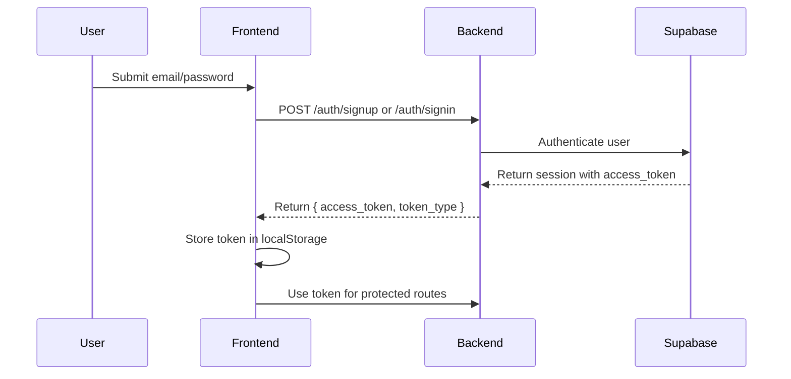

# Comprehensive Frontend Integration Guide
## Spam Classifier Backend API

This guide provides complete information for integrating your React/Vite frontend with the FastAPI backend, including exact schemas, authentication flows, and implementation examples.

---

## 🔧 Backend Information

- **Development URL**: `http://127.0.0.1:8000`
- **Production URL**: `https://spam-classifier-ba4i.vercel.app`
- **API Documentation**: Visit `/docs` for interactive Swagger UI
- **CORS**: Configured to allow `localhost:3000`, `localhost:5173`, `localhost:4173`

---

## 📦 Prerequisites

### Install Dependencies
```bash
npm install axios
```

### Environment Variables
Create a `.env` file in your frontend project root:

```env
# Development
VITE_BACKEND_URL=http://127.0.0.1:8000

# Production
# VITE_BACKEND_URL=https://spam-classifier-ba4i.vercel.app
```

---

## 🔐 Authentication Flow Overview



---

## 📡 API Endpoints Reference

### 1. Authentication Endpoints

#### **POST /auth/signup**
Register a new user account.

**Request Schema:**
```typescript
interface SignupRequest {
  email: string;      // Must be valid email format
  password: string;   // Minimum 6 characters (Supabase default)
}
```

**Request Example:**
```typescript
{
  "email": "user@example.com",
  "password": "securepassword123"
}
```

**Success Response (200):**
```typescript
interface SignupResponse {
  message: string;
  user: {
    id: string;        // UUID format
    email: string;
  };
}
```

**Success Example:**
```json
{
  "message": "User created successfully",
  "user": {
    "id": "7e3082ec-22bc-4be1-9a3d-04d0af4a1030",
    "email": "user@example.com"
  }
}
```

**Error Responses:**
- **400 Bad Request**: Email already exists, weak password, or validation error
- **503 Service Unavailable**: Database connection issue

---

#### **POST /auth/signin**
Authenticate existing user and get access token.

**Request Schema:**
```typescript
interface SigninRequest {
  email: string;
  password: string;
}
```

**Request Example:**
```json
{
  "email": "user@example.com",
  "password": "securepassword123"
}
```

**Success Response (200):**
```typescript
interface SigninResponse {
  access_token: string;  // JWT token for authenticated requests
  token_type: string;    // Always "bearer"
}
```

**Success Example:**
```json
{
  "access_token": "eyJhbGciOiJFUzI1NiIsImtpZCI6ImM1Y2RlZmQwLWRmYjYtNDU3MC1hNTk0LTkwMzU3MjZkYTY5MyIsInR5cCI6IkpXVCJ9...",
  "token_type": "bearer"
}
```

**Error Responses:**
- **400 Bad Request**: Invalid email format or request structure
- **401 Unauthorized**: Invalid email or password
- **503 Service Unavailable**: Database connection issue

---

### 2. API Key Management Endpoints

All API Key endpoints require authentication via Bearer token.

#### **GET /auth/api-keys**
List all API keys for the authenticated user.

**Headers Required:**
```typescript
{
  "Authorization": "Bearer <access_token>"
}
```

**Success Response (200):**
```typescript
interface ApiKey {
  key: string;         // The actual API key (e.g., "sc_abc123...")
  name: string;        // User-defined key name
  created_at: string;  // ISO 8601 datetime string
}

type ApiKeysListResponse = ApiKey[];
```

**Success Example:**
```json
[
  {
    "key": "sc_1a2b3c4d5e6f7g8h9i0j",
    "name": "Production Key",
    "created_at": "2026-01-15T10:30:00Z"
  },
  {
    "key": "sc_9j8i7h6g5f4e3d2c1b0a",
    "name": "Development Key",
    "created_at": "2026-01-14T15:45:00Z"
  }
]
```

**Error Responses:**
- **401 Unauthorized**: Missing, invalid, or expired token

---

#### **POST /auth/api-keys**
Create a new API key for the authenticated user.

**Headers Required:**
```typescript
{
  "Authorization": "Bearer <access_token>"
}
```

**Request Schema:**
```typescript
interface CreateApiKeyRequest {
  name?: string;  // Optional, defaults to "Default Key"
}
```

**Request Example:**
```json
{
  "name": "My Frontend App Key"
}
```

**Success Response (200):**
```typescript
interface CreateApiKeyResponse {
  key: string;         // New API key with "sc_" prefix
  name: string;        // Key name
  created_at: string;  // ISO 8601 datetime string
}
```

**Success Example:**
```json
{
  "key": "sc_k9j8h7g6f5e4d3c2b1a0",
  "name": "My Frontend App Key",
  "created_at": "2026-01-15T12:00:00Z"
}
```

**Error Responses:**
- **401 Unauthorized**: Missing, invalid, or expired token
- **503 Service Unavailable**: Database error

---

#### **DELETE /auth/api-keys/{key}**
Revoke/delete a specific API key.

**Headers Required:**
```typescript
{
  "Authorization": "Bearer <access_token>"
}
```

**Path Parameters:**
- `key` (string): The API key to revoke (e.g., "sc_abc123...")

**URL Example:**
```
DELETE /auth/api-keys/sc_1a2b3c4d5e6f7g8h9i0j
```

**Success Response (200):**
```typescript
interface RevokeApiKeyResponse {
  status: string;  // Always "revoked"
}
```

**Success Example:**
```json
{
  "status": "revoked"
}
```

**Error Responses:**
- **401 Unauthorized**: Missing, invalid, or expired token
- **404 Not Found**: API key doesn't exist or doesn't belong to user

---

### 3. Spam Detection Endpoint

#### **POST /spam/detect_spam**
Analyze text for spam content.

**Headers Required:**
```typescript
{
  "X-API-Key": "<user_api_key>"  // The sc_... key from API key management
}
```

**Request Schema:**
```typescript
interface DetectSpamRequest {
  text: string;  // Text to analyze for spam
}
```

**Request Example:**
```json
{
  "text": "Check this out: http://suspicious-link.com/offer"
}
```

**Success Response (200):**
```typescript
interface AnalysisResult {
  response_text: string;       // Human-readable analysis summary
  is_spam: boolean;            // True if message is spam
  confidence: number;          // 0-100 confidence score
  details: {
    urls?: UrlAnalysis[];      // Array of URLs found and their analysis
    domains?: DomainAnalysis[]; // Domain-level information
    // ... additional fields based on analysis
  };
}

interface UrlAnalysis {
  url: string;
  is_suspicious: boolean;
  reasons: string[];
}

interface DomainAnalysis {
  domain: string;
  age_days?: number;
  registrar?: string;
  is_suspicious: boolean;
}
```

**Success Example:**
```json
{
  "response_text": "⚠️ SPAM DETECTED\n\nThis message appears to be spam with 85% confidence.\n\nReasons:\n- Contains suspicious URL: http://suspicious-link.com/offer\n- Domain recently registered (15 days old)\n- Generic promotional language detected",
  "is_spam": true,
  "confidence": 85,
  "details": {
    "urls": [
      {
        "url": "http://suspicious-link.com/offer",
        "is_suspicious": true,
        "reasons": ["Young domain", "VirusTotal flagged"]
      }
    ],
    "domains": [
      {
        "domain": "suspicious-link.com",
        "age_days": 15,
        "registrar": "Namecheap",
        "is_suspicious": true
      }
    ]
  }
}
```

**Error Responses:**
- **401 Unauthorized**: Missing or invalid API key
- **429 Too Many Requests**: Rate limit exceeded (5 requests/minute)
- **400 Bad Request**: Invalid request format

---

## 💻 Implementation Guide

### Step 1: Create API Client (`src/lib/api.ts`)

```typescript
import axios, { AxiosError } from 'axios';

// Backend URL from environment variables
const API_URL = import.meta.env.VITE_BACKEND_URL || 'http://127.0.0.1:8000';

// Create axios instance
export const api = axios.create({
  baseURL: API_URL,
  headers: {
    'Content-Type': 'application/json',
  },
});

// Request interceptor to add auth token
api.interceptors.request.use(
  async (config) => {
    // Add Bearer token to protected /auth routes (except signup/signin)
    const isAuthRoute = config.url?.startsWith('/auth/');
    const isPublicAuth = config.url === '/auth/signup' || config.url === '/auth/signin';

    if (isAuthRoute && !isPublicAuth) {
      const token = localStorage.getItem('access_token');
      if (token) {
        config.headers.Authorization = `Bearer ${token}`;
      }
    }

    return config;
  },
  (error) => Promise.reject(error)
);

// Response interceptor for error handling
api.interceptors.response.use(
  (response) => response,
  (error: AxiosError<{ detail: string }>) => {
    // Handle specific error cases
    if (error.response?.status === 401) {
      // Token expired or invalid - redirect to login
      localStorage.removeItem('access_token');
      window.location.href = '/login';
    }
    
    return Promise.reject(error);
  }
);

// TypeScript interfaces
export interface SignupRequest {
  email: string;
  password: string;
}

export interface SigninRequest {
  email: string;
  password: string;
}

export interface SignupResponse {
  message: string;
  user: {
    id: string;
    email: string;
  };
}

export interface SigninResponse {
  access_token: string;
  token_type: string;
}

export interface ApiKey {
  key: string;
  name: string;
  created_at: string;
}

export interface CreateApiKeyRequest {
  name?: string;
}

export interface DetectSpamRequest {
  text: string;
}

export interface AnalysisResult {
  response_text: string;
  is_spam: boolean;
  confidence: number;
  details: Record<string, any>;
}

// Auth API methods
export const authApi = {
  signup: (data: SignupRequest) => 
    api.post<SignupResponse>('/auth/signup', data),
  
  signin: (data: SigninRequest) => 
    api.post<SigninResponse>('/auth/signin', data),
  
  listApiKeys: () => 
    api.get<ApiKey[]>('/auth/api-keys'),
  
  createApiKey: (data: CreateApiKeyRequest) => 
    api.post<ApiKey>('/auth/api-keys', data),
  
  deleteApiKey: (key: string) => 
    api.delete<{ status: string }>(`/auth/api-keys/${key}`),
};

// Spam detection API methods
export const spamApi = {
  detectSpam: (text: string, apiKey: string) => 
    api.post<AnalysisResult>(
      '/spam/detect_spam',
      { text },
      {
        headers: {
          'X-API-Key': apiKey,
        },
      }
    ),
};
```

---

### Step 2: Create Auth Context (`src/contexts/AuthContext.tsx`)

```typescript
import React, { createContext, useContext, useState, useEffect } from 'react';
import { authApi, SigninResponse } from '@/lib/api';

interface AuthContextType {
  isAuthenticated: boolean;
  accessToken: string | null;
  login: (email: string, password: string) => Promise<void>;
  signup: (email: string, password: string) => Promise<void>;
  logout: () => void;
  loading: boolean;
}

const AuthContext = createContext<AuthContextType | undefined>(undefined);

export function AuthProvider({ children }: { children: React.ReactNode }) {
  const [accessToken, setAccessToken] = useState<string | null>(null);
  const [loading, setLoading] = useState(true);

  useEffect(() => {
    // Check for existing token on mount
    const token = localStorage.getItem('access_token');
    if (token) {
      setAccessToken(token);
    }
    setLoading(false);
  }, []);

  const signup = async (email: string, password: string) => {
    const response = await authApi.signup({ email, password });
    // After signup, user needs to sign in
    console.log('User created:', response.data.user);
  };

  const login = async (email: string, password: string) => {
    const response = await authApi.signin({ email, password });
    const { access_token } = response.data;
    
    localStorage.setItem('access_token', access_token);
    setAccessToken(access_token);
  };

  const logout = () => {
    localStorage.removeItem('access_token');
    setAccessToken(null);
  };

  return (
    <AuthContext.Provider
      value={{
        isAuthenticated: !!accessToken,
        accessToken,
        login,
        signup,
        logout,
        loading,
      }}
    >
      {children}
    </AuthContext.Provider>
  );
}

export function useAuth() {
  const context = useContext(AuthContext);
  if (!context) {
    throw new Error('useAuth must be used within AuthProvider');
  }
  return context;
}
```

---

### Step 3: Create Login Form Component

```typescript
import { useState } from 'react';
import { useAuth } from '@/contexts/AuthContext';
import { useNavigate } from 'react-router-dom';

export function LoginForm() {
  const [email, setEmail] = useState('');
  const [password, setPassword] = useState('');
  const [error, setError] = useState('');
  const [loading, setLoading] = useState(false);
  const { login } = useAuth();
  const navigate = useNavigate();

  const handleSubmit = async (e: React.FormEvent) => {
    e.preventDefault();
    setError('');
    setLoading(true);

    try {
      await login(email, password);
      navigate('/dashboard');
    } catch (err: any) {
      const errorMessage = err.response?.data?.detail || 'Failed to sign in';
      setError(errorMessage);
    } finally {
      setLoading(false);
    }
  };

  return (
    <form onSubmit={handleSubmit}>
      <div>
        <label htmlFor="email">Email</label>
        <input
          id="email"
          type="email"
          value={email}
          onChange={(e) => setEmail(e.target.value)}
          required
        />
      </div>

      <div>
        <label htmlFor="password">Password</label>
        <input
          id="password"
          type="password"
          value={password}
          onChange={(e) => setPassword(e.target.value)}
          required
          minLength={6}
        />
      </div>

      {error && <p className="error">{error}</p>}

      <button type="submit" disabled={loading}>
        {loading ? 'Signing in...' : 'Sign In'}
      </button>
    </form>
  );
}
```

---

### Step 4: API Key Management Component

```typescript
import { useState, useEffect } from 'react';
import { authApi, ApiKey } from '@/lib/api';

export function ApiKeyManager() {
  const [apiKeys, setApiKeys] = useState<ApiKey[]>([]);
  const [keyName, setKeyName] = useState('');
  const [loading, setLoading] = useState(false);
  const [error, setError] = useState('');

  useEffect(() => {
    loadApiKeys();
  }, []);

  const loadApiKeys = async () => {
    try {
      const response = await authApi.listApiKeys();
      setApiKeys(response.data);
    } catch (err: any) {
      setError('Failed to load API keys');
      console.error(err);
    }
  };

  const createKey = async () => {
    setLoading(true);
    setError('');
    
    try {
      const response = await authApi.createApiKey({ 
        name: keyName || 'Default Key' 
      });
      
      setApiKeys([...apiKeys, response.data]);
      setKeyName('');
      alert(`New API Key created: ${response.data.key}`);
    } catch (err: any) {
      setError(err.response?.data?.detail || 'Failed to create key');
    } finally {
      setLoading(false);
    }
  };

  const revokeKey = async (key: string) => {
    if (!confirm('Are you sure you want to revoke this key?')) return;

    try {
      await authApi.deleteApiKey(key);
      setApiKeys(apiKeys.filter(k => k.key !== key));
    } catch (err: any) {
      setError(err.response?.data?.detail || 'Failed to revoke key');
    }
  };

  return (
    <div>
      <h2>API Key Management</h2>

      {/* Create New Key */}
      <div>
        <input
          type="text"
          placeholder="Key name (optional)"
          value={keyName}
          onChange={(e) => setKeyName(e.target.value)}
        />
        <button onClick={createKey} disabled={loading}>
          {loading ? 'Creating...' : 'Create New Key'}
        </button>
      </div>

      {error && <p className="error">{error}</p>}

      {/* List Existing Keys */}
      <div>
        <h3>Your API Keys</h3>
        {apiKeys.length === 0 ? (
          <p>No API keys yet. Create one to get started!</p>
        ) : (
          <ul>
            {apiKeys.map((key) => (
              <li key={key.key}>
                <div>
                  <strong>{key.name}</strong>
                  <code>{key.key}</code>
                  <small>{new Date(key.created_at).toLocaleString()}</small>
                </div>
                <button onClick={() => revokeKey(key.key)}>Revoke</button>
              </li>
            ))}
          </ul>
        )}
      </div>
    </div>
  );
}
```

---

### Step 5: Spam Detection Component

```typescript
import { useState } from 'react';
import { spamApi, AnalysisResult } from '@/lib/api';

interface SpamDetectorProps {
  userApiKey: string; // Pass the user's API key as a prop
}

export function SpamDetector({ userApiKey }: SpamDetectorProps) {
  const [text, setText] = useState('');
  const [result, setResult] = useState<AnalysisResult | null>(null);
  const [loading, setLoading] = useState(false);
  const [error, setError] = useState('');

  const analyzeText = async () => {
    if (!text.trim()) {
      setError('Please enter some text to analyze');
      return;
    }

    setLoading(true);
    setError('');
    setResult(null);

    try {
      const response = await spamApi.detectSpam(text, userApiKey);
      setResult(response.data);
    } catch (err: any) {
      if (err.response?.status === 429) {
        setError('Rate limit exceeded. Please wait a minute.');
      } else {
        setError(err.response?.data?.detail || 'Failed to analyze text');
      }
    } finally {
      setLoading(false);
    }
  };

  return (
    <div>
      <h2>Spam Detection</h2>

      <textarea
        value={text}
        onChange={(e) => setText(e.target.value)}
        placeholder="Enter text or message to analyze..."
        rows={5}
      />

      <button onClick={analyzeText} disabled={loading || !userApiKey}>
        {loading ? 'Analyzing...' : 'Check for Spam'}
      </button>

      {!userApiKey && (
        <p className="warning">Please create an API key first!</p>
      )}

      {error && <p className="error">{error}</p>}

      {result && (
        <div className={result.is_spam ? 'result-spam' : 'result-safe'}>
          <h3>{result.is_spam ? '⚠️ Spam Detected' : '✅ Looks Safe'}</h3>
          <p><strong>Confidence:</strong> {result.confidence}%</p>
          <pre>{result.response_text}</pre>
          
          {result.details && (
            <details>
              <summary>View Full Details</summary>
              <pre>{JSON.stringify(result.details, null, 2)}</pre>
            </details>
          )}
        </div>
      )}
    </div>
  );
}
```

---

## 🚨 Error Handling Guide

### Common Error Scenarios

```typescript
import { AxiosError } from 'axios';

function handleApiError(error: unknown) {
  if (error instanceof AxiosError) {
    const status = error.response?.status;
    const detail = error.response?.data?.detail;

    switch (status) {
      case 400:
        return `Bad Request: ${detail || 'Invalid input'}`;
      
      case 401:
        localStorage.removeItem('access_token');
        window.location.href = '/login';
        return 'Session expired. Please login again.';
      
      case 403:
        return 'Access forbidden. Check your API key.';
      
      case 404:
        return 'Resource not found';
      
      case 429:
        return 'Rate limit exceeded. Please wait before trying again.';
      
      case 503:
        return 'Service temporarily unavailable. Please try again later.';
      
      default:
        return detail || 'An unexpected error occurred';
    }
  }
  
  return 'Network error. Please check your connection.';
}
```

---

## 🔒 Security Best Practices

### 1. Token Storage
```typescript
// ✅ Good: Use localStorage for access tokens
localStorage.setItem('access_token', token);

// ❌ Bad: Don't store in cookies without httpOnly flag
// ❌ Bad: Don't store in sessionStorage if you want persistence
```

### 2. API Key Handling
```typescript
// ✅ Good: Never expose API keys in frontend code
// Pass them securely from backend or user input

// ❌ Bad: Don't hardcode API keys
const API_KEY = 'sc_hardcoded123'; // DON'T DO THIS
```

### 3. Validate Input
```typescript
// ✅ Good: Validate before sending
if (password.length < 6) {
  setError('Password must be at least 6 characters');
  return;
}

// ✅ Good: Sanitize user input for display
const sanitizedText = DOMPurify.sanitize(userInput);
```

---

## 📋 Testing Checklist

- [ ] Signup creates user successfully
- [ ] Signin returns access token
- [ ] Token persists after page reload
- [ ] Protected routes require authentication
- [ ] API key creation works
- [ ] API key listing shows all keys
- [ ] API key deletion removes key
- [ ] Spam detection returns results with valid key
- [ ] Rate limiting triggers after 5 requests/minute
- [ ] Error messages display correctly
- [ ] Logout clears token and redirects

---

## 🎯 Quick Start Summary

1. **Copy `api.ts`** to your project
2. **Set environment variable** `VITE_BACKEND_URL`
3. **Wrap app with AuthProvider**
4. **Implement login/signup forms**
5. **Create API key management UI**
6. **Build spam detection interface**
7. **Test all flows end-to-end**

---

## 🐛 Troubleshooting

### "CORS Error"
- Ensure your frontend URL is in the backend's CORS allowed origins
- Check `main.py` line 26-31

### "Invalid or expired token"
- Token might be expired (check expiry in JWT)
- Clear localStorage and login again
- Verify token is being sent in Authorization header

### "Rate limit exceeded"
- Wait 60 seconds before retrying
- Implement client-side rate limiting to prevent this

### "Database unavailable" (503)
- Backend can't connect to Supabase
- Check backend environment variables
- Verify Supabase credentials

---

## 📞 Support

For issues or questions:
- Check `/docs` endpoint on your backend for live API documentation
- Review backend logs for detailed error messages
- Verify all environment variables are set correctly

---

**Last Updated:** January 15, 2026
**Backend Version:** 1.0
**Compatible Frontend:** React 18+, Vite 4+
