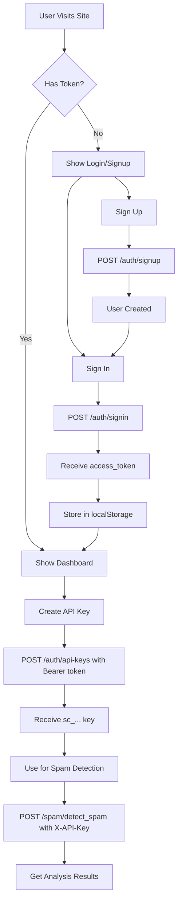

# Frontend Integration Package - Complete Index

Welcome! This directory contains everything you need to integrate your React/Vite frontend with the Spam Classifier Backend API.

---

## 📦 What's Included

This package contains **6 files** designed to make frontend integration as smooth as possible:

### 📖 Documentation (3 files)

1. **`COMPREHENSIVE_INTEGRATION_GUIDE.md`** ⭐ **START HERE**
   - 📏 Length: ~650 lines
   - 🎯 Purpose: Complete reference with detailed schemas, examples, and best practices
   - 📚 Contains:
     - Every API endpoint with exact request/response schemas
     - TypeScript interfaces
     - Complete React component examples
     - Authentication flow diagrams
     - Error handling strategies
     - Security best practices
     - Testing checklist
   - ⏱️ Read time: 15-20 minutes

2. **`QUICK_REFERENCE.md`** 📋 **Quick Lookup**
   - 📏 Length: ~150 lines
   - 🎯 Purpose: At-a-glance reference card
   - 📚 Contains:
     - 5-minute integration guide
     - Common tasks with code snippets
     - Quick troubleshooting table
     - Authentication flow diagram
     - Request/response examples
   - ⏱️ Read time: 3-5 minutes

3. **`ENVIRONMENT_SETUP.md`** ⚙️ **Configuration Guide**
   - 📏 Length: ~150 lines
   - 🎯 Purpose: Environment configuration and setup
   - 📚 Contains:
     - Frontend `.env` examples
     - Backend environment variables reference
     - CORS configuration
     - Connection testing methods
     - Troubleshooting guide
     - Security checklist
   - ⏱️ Read time: 5-8 minutes

### 💻 Code Files (3 files)

4. **`api.ts`** 🔌 **API Client**
   - 📏 Length: ~150 lines
   - 🎯 Purpose: Production-ready TypeScript API client
   - 📚 Contains:
     - Axios instance with interceptors
     - Automatic token injection
     - TypeScript interfaces for all requests/responses
     - Error handling utilities
     - All API methods (auth, API keys, spam detection)
   - 🚀 Action: **Copy this to your `src/lib/` folder**

5. **`example-components.tsx`** 🎨 **React Components**
   - 📏 Length: ~400 lines
   - 🎯 Purpose: Ready-to-use React components
   - 📚 Contains:
     - `SignupForm` - User registration
     - `LoginForm` - User authentication
     - `ApiKeyManager` - Create, list, and revoke API keys
     - `SpamDetector` - Spam detection interface
     - `LogoutButton` - Logout functionality
     - Example CSS styles
   - 🚀 Action: **Copy components you need and customize**

6. **`README.md`** 📄 **Quick Overview**
   - 📏 Length: ~120 lines
   - 🎯 Purpose: Package overview and quick start
   - 📚 Contains:
     - File descriptions
     - Quick start guide
     - Usage examples
     - Links to other documents

---

## 🗺️ Integration Roadmap

Follow this path for the smoothest integration experience:

### Phase 1: Understanding (15 minutes)
```
1. Read this INDEX.md (you are here!)
2. Skim QUICK_REFERENCE.md for overview
3. Read COMPREHENSIVE_INTEGRATION_GUIDE.md thoroughly
```

### Phase 2: Setup (10 minutes)
```
4. Follow ENVIRONMENT_SETUP.md to configure .env
5. Copy api.ts to your project (src/lib/)
6. Install dependencies: npm install axios
7. Test connection to backend
```

### Phase 3: Implementation (30-60 minutes)
```
8. Copy components from example-components.tsx
9. Customize components for your design
10. Implement authentication flow
11. Add API key management
12. Build spam detection UI
```

### Phase 4: Testing (15 minutes)
```
13. Test signup/signin flow
14. Test API key creation/deletion
15. Test spam detection with different inputs
16. Test error handling
17. Check rate limiting behavior
```

---

## 📊 Backend API Summary

Your backend provides **6 endpoints** across **3 functional areas**:

### 🔐 Authentication (2 endpoints)
- **POST** `/auth/signup` - Register new user → Returns user object
- **POST** `/auth/signin` - Login → Returns `access_token`

### 🔑 API Key Management (3 endpoints - requires Bearer token)
- **GET** `/auth/api-keys` - List all user's API keys
- **POST** `/auth/api-keys` - Create new API key → Returns `sc_...` key
- **DELETE** `/auth/api-keys/{key}` - Revoke API key

### 🛡️ Spam Detection (1 endpoint - requires X-API-Key)
- **POST** `/spam/detect_spam` - Analyze text → Returns spam verdict

---

## 🎯 Quick Decision Guide

**"I just want to get started quickly!"**
→ Read `QUICK_REFERENCE.md` + Copy `api.ts`

**"I need to understand everything properly"**
→ Read `COMPREHENSIVE_INTEGRATION_GUIDE.md` thoroughly

**"I'm having environment/setup issues"**
→ Check `ENVIRONMENT_SETUP.md`

**"I need example React components"**
→ Copy from `example-components.tsx`

**"I want a working example of X"**
→ Search `COMPREHENSIVE_INTEGRATION_GUIDE.md` for "Step X"

---

## 🔄 Authentication Flow Quick View



---

## 📦 File Sizes & Load Times

| File | Size | Load Time (avg) |
|------|------|----------------|
| `COMPREHENSIVE_INTEGRATION_GUIDE.md` | ~23 KB | 15-20 min read |
| `example-components.tsx` | ~18 KB | Reference |
| `QUICK_REFERENCE.md` | ~6.5 KB | 3-5 min read |
| `README.md` | ~4.7 KB | 2-3 min read |
| `ENVIRONMENT_SETUP.md` | ~4.5 KB | 5-8 min read |
| `api.ts` | ~4.1 KB | Copy to project |

**Total Package Size:** ~60.8 KB

---

## ✅ Integration Checklist

Use this checklist to track your progress:

### Setup & Configuration
- [ ] Read `COMPREHENSIVE_INTEGRATION_GUIDE.md`
- [ ] Backend is running on `http://127.0.0.1:8000`
- [ ] Can access backend `/docs` in browser
- [ ] Created `.env` with `VITE_BACKEND_URL`
- [ ] Installed `axios` in frontend
- [ ] Copied `api.ts` to project
- [ ] Frontend URL is in backend's CORS allowed origins

### Authentication Implementation
- [ ] Implemented signup form
- [ ] Implemented login form
- [ ] Token is stored in localStorage after login
- [ ] Token persists after page reload
- [ ] Logout clears token and redirects
- [ ] Protected routes check for token

### API Key Management
- [ ] Can create new API keys
- [ ] Can list all API keys
- [ ] Can copy API keys to clipboard
- [ ] Can delete/revoke API keys
- [ ] API key creation shows key to user

### Spam Detection
- [ ] Spam detection form accepts text input
- [ ] Requires API key (from user input or selection)
- [ ] Shows loading state during analysis
- [ ] Displays results clearly (spam vs safe)
- [ ] Shows confidence score
- [ ] Handles errors gracefully
- [ ] Respects rate limits

### Error Handling
- [ ] Displays user-friendly error messages
- [ ] Handles 401 (unauthorized) errors
- [ ] Handles 429 (rate limit) errors
- [ ] Handles network errors
- [ ] Shows validation errors for forms

### Testing
- [ ] Tested complete signup → signin → create key → detect spam flow
- [ ] Tested error scenarios
- [ ] Tested rate limiting (make >5 requests in 1 minute)
- [ ] Tested with both spam and legitimate text
- [ ] Tested logout and re-login

---

## 🆘 Support Resources

### When You're Stuck

1. **For API Questions:** Check `COMPREHENSIVE_INTEGRATION_GUIDE.md`
2. **For Setup Issues:** See `ENVIRONMENT_SETUP.md`
3. **For Quick Answers:** Use `QUICK_REFERENCE.md`
4. **For Code Examples:** Browse `example-components.tsx`
5. **For Live Testing:** Use backend `/docs` (Swagger UI)

### Common Issues & Solutions

| Issue | Document to Check | Section |
|-------|------------------|---------|
| CORS errors | `ENVIRONMENT_SETUP.md` | Troubleshooting |
| Token not working | `COMPREHENSIVE_INTEGRATION_GUIDE.md` | Error Handling |
| API schemas unclear | `COMPREHENSIVE_INTEGRATION_GUIDE.md` | API Endpoints Reference |
| Component examples | `example-components.tsx` | All components |
| Rate limiting | `QUICK_REFERENCE.md` | Important Limits |

---

## 🎓 Learning Path

### Beginner (Never used FastAPI/React together)
1. Read `QUICK_REFERENCE.md` fully
2. Read `COMPREHENSIVE_INTEGRATION_GUIDE.md` sections 1-5
3. Follow setup in `ENVIRONMENT_SETUP.md`
4. Test connection in browser console
5. Copy and modify one component at a time
6. Test each feature as you build

### Intermediate (Some API integration experience)
1. Skim `QUICK_REFERENCE.md`
2. Read `COMPREHENSIVE_INTEGRATION_GUIDE.md` API section
3. Copy `api.ts` and components
4. Customize to your needs
5. Test thoroughly

### Advanced (Experienced developer)
1. Check `QUICK_REFERENCE.md` for endpoints
2. Review TypeScript interfaces in `api.ts`
3. Use as reference, build custom implementation
4. Refer to docs as needed

---

## 🚀 You're Ready!

Everything you need is in this directory. The backend is **working perfectly** (you tested it in `/docs`), and now you have:

✅ Complete documentation
✅ Ready-to-use API client
✅ Example React components
✅ Environment setup guide
✅ Quick reference card
✅ This comprehensive index

**Next Step:** Open `COMPREHENSIVE_INTEGRATION_GUIDE.md` and start building! 🎉

---

## 📞 Quick Links

- **Backend API Docs:** `http://127.0.0.1:8000/docs`
- **Backend Root:** `http://127.0.0.1:8000`
- **Production Backend:** `https://spam-classifier-ba4i.vercel.app`

---

**Package Version:** 1.0  
**Last Updated:** January 15, 2026  
**Backend Compatible:** Spam Classifier API v1.0  
**Frontend Compatible:** React 18+, Vite 4+  

---

Happy coding! 🚀
